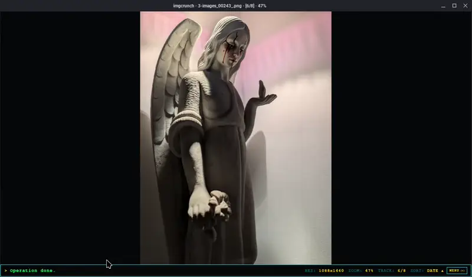

# IMGCRUNCH

```text
 ___ __  __  ____ ____ ____  _   _ _   _  ____ _   _ 
|_ _|  \/  |/ ___/ ___|  _ \| | | | \ | |/ ___| | | |
 | || |\/| | |  | |   | |_) | | | |  \| | |   | |_| |
 | || |  | | |__| |___|  _ <| |_| | |\  | |___|  _  |
|___|_|  |_|\____\____|_| \_\\___/|_| \_|\____|_| |_|
  [ CLASSIFIED IMAGE VIEWER // 1992 ORIGINAL SEIZURES ]
```


> *"Some code doesn't just run. It crunches."*

### Hardware-Accelerated Forensic Inspection, Error Level Analysis & Neural Vision Terminal.
###### Zero telemetry. Zero cloud crutches. Pure offline silicon. It tears into the bytes you feed it, when you feed it.

<br>

<div align="center">
  <!-- HERO DEMO // PLACEHOLDER FOR SMILEDOG 5-MODE RECORDING -->
  
</div>

<br>

---

> [!CAUTION]
> ### ⚠️ PHOTOSENSITIVITY WARNING // SEIZURES™ (ORIGINAL 1990s EDITION)
> The violent screen strobing and border flashing during pipeline execution is the **AUTHENTIC 1990s DEMOSCENE CRUNCHER EFFECT™**.
>
> It indicates that the pure Rust native engine is actively decompressing byte streams, computing differential Error Level Analysis matrices, and rasterizing high-density glyphs directly into raw pixel buffers. The presence of violent flashing means the software is **WORKING AS INTENDED**. That is just Rust getting crunched in the background.
>
> Anyone forking this repository to replace the cruncher flash with a sanitized modern circular progress indicator will be summarily and permanently blocked with extreme prejudice.

---

## 💾 The Man & The Machine

While much of modern software has devolved into bloated Electron web wrappers consuming half a gigabyte of RAM just to display a JPEG, clean tools like `qimgv` still exist (and served as a major inspiration here). But every image viewer dictates user workflow.

**IMGCRUNCH is a combo to shmix you up.**

Forged on Arch Linux, IMGCRUNCH was built to pair a raw, retro UI with blistering native performance. Low-level systems languages like Rust shine at high-throughput pixel crunching, but because of how Rust is structured, complex nested UI trees are notoriously painful to build. Bringing these two worlds together is the core philosophy of IMGCRUNCH: embedding handwritten Rust inside Flutter Desktop yields the best of both worlds — a responsive, hardware-accelerated frontend with Rust doing all the heavy computational lifting behind the scenes (file scanning, image processing, ...).

**Actively Dogfooded During Degen Hours:**  
This tool is daily-driven on actual workloads. Features get implemented because the maintainer genuinely needed them to navigate folders of cursed imagery at 3 AM... Another package broke, an image viewer was needed, and things escalated. As such, expect sharp edges, raw corners, active evolution, and mechanics that shift daily based on real-world combat.

* **Zero Telemetry:** The engine runs entirely on local silicon. It does not phone home, ping remote analytics endpoints, or upload your media to centralized silos.
* **Zero Permissions:** IMGCRUNCH operates strictly in unprivileged user space. No root/sudo escalations, no background services. It just opens images, crunches Rust, and blinds you with demoscene raster bars in the process — exactly as intended.

---

## ⚡ Five Forensic Strata (Quake Weapon-Switching)

Mode switching isn't buried in menus or dropdowns. It operates with the twitch-reflex immediacy of **Quake weapon switching**: numerical triggers (`1` through `5`) instantly swap the active forensic weapons without lifting your hand off the keyboard or fumbling with a mouse:

```text
 [1] RAW VIEWPORT    ➔ Hardware-accelerated subpixel pan/zoom matrix
 [2] ELA FORENSIC    ➔ Amplified differential Error Level Analysis (Rust)
 [3] CRT ASCII ART   ➔ Perceptual luminance rasterizer with glowing phosphor glyphs (Rust)
 [4] STRINGS DUMP    ➔ Contiguous printable ASCII byte sequence extraction (Rust)
 [5] NEURAL VLM      ➔ Dual-payload multimodal vision intelligence dossier
```

### `[1]` RAW VIEWPORT // The Specimen Deck
* **Subpixel Pan & Zoom:** Custom coordinate transform matrix supporting seamless freeform zooming (NEAREST NEIGHBOUR when scaling up, LINEAR when scaling down), infinite zoom out, border clamping, and one-key `100%` actual-size focus (`0`).
* **Format Agnostic:** Ingests PNG, JPEG (JPG), GIF (with live animated frame playback), WebP, BMP, and ICO (adding more friends along the way).
* **Instant Ingestion:** Drag-and-drop any file directly into the cathode well, pass it as a CLI argument, or paste image buffers straight from the system clipboard (`Ctrl+V`).

### `[2]` ELA // Error Level Analysis
* **Pure Rust Differential Engine:** Re-compresses the image container against a calibrated baseline ($Q=25$) and computes the absolute pixel-by-pixel mathematical delta in native memory.
* **Tampering Identification:** Exposes digital splicing, cloning, localized brush touch-ups, resaved boundaries, and generative AI inpainting artifacts as brilliant luminous anomalies against uniform dark compression noise.
* **Zero CPU Freezing:** Heavy image differences process inside native worker threads, keeping the UI at a pinned 60fps.

### `[3]` ASCII // Phosphor CRT Rasterizer
* **Perceptual Luminance Mapping:** Converts RGB pixel data to greyscale using calibrated human eye weights ($0.2126R + 0.7152G + 0.0722B$), mapped to inverted CRT character densities (`.`, `:`, `;`, `+`, `*`, `%`, `#`).
* **High-Luminance Phosphor Punch:** Draws glyphs using high-density `#00FF66` phosphor green (`RGBA[0, 255, 102, 245]`) on pure cathode black (`#05070B`), preventing downsampling washout on high-DPI displays.
* **Custom Aspect Correction:** Compensates for non-square font bounding boxes with live configurable character aspect ratios.

### `[4]` STRINGS // Firmware & Binary Artifact Dump
* **Raw Byte Extraction:** Sweeps the raw file byte stream for contiguous printable ASCII sequences (configurable minimum length $\ge 6$ bytes).
* **Metadata Exfiltration:** Instantly surfaces hidden camera models, EXIF timestamps, software signatures, GPS tags, embedded ComfyUI generation prompts, and steghide trailers without requiring external CLI utilities.

### `[5]` NEURAL VLM // Multimodal Forensic Dossier
* **Dual-Image Forensic Fusion:** Pipes both the **original image** AND the **amplified ELA delta map** simultaneously into local (Ollama, vLLM, LM Studio) or remote (OpenAI, Gemini) Vision Language Models.
* **Ground-Truth Environment Telemetry:** Automatically injects atomic UTC timestamps, exact byte sizes, file modification times, and extracted strings into the prompt context to ground the model and eliminate temporal hallucinations.
* **Sunken CRT Markdown Terminal:** Streams real-time SSE token responses into a retro terminal featuring phosphor headers, glowing amber callouts, and steel-bordered code containers wrapped in native mouse `SelectionArea`.
* **Dual `[MD / RAW]` Mode:** Toggle between formatted forensic dossier reports and raw token dumps with a single click.

---

## 🔬 The Surgical Pixel Peeker (`P`)

Press `P` to deploy the floating **9x Nearest-Neighbor Pixel Peeker Loupe**:
* **Subpixel Reticle:** Centers a calibrated high-precision crosshair over any pixel coordinate.
* **Hardware Readout:** Displays exact `(X, Y)` spatial coordinates, 24-bit hexadecimal color code (`#RRGGBB`), and raw 8-bit `RGB(r, g, b)` channel values in real time.
* **Subpixel Grid Canvas:** Renders a magnified pixel grid with hairline wireframe borders for inspecting compression edge discontinuities and steganographic color shifts.

---

## ⌨️ Mapped Controls

| Key Trigger | Action & Operation |
| :--- | :--- |
| `1` | Switch to **Mode 1: Normal Viewport** |
| `2` | Switch to **Mode 2: Error Level Analysis (ELA)** |
| `3` | Switch to **Mode 3: Phosphor CRT ASCII Art** |
| `4` | Switch to **Mode 4: Forensic Strings Extraction** |
| `5` | Switch to **Mode 5: Multimodal VLM Neural Terminal** |
| `Space` / `→` | Advance to **Next Specimen** in playlist directory |
| `Shift+Space` / `←` | Return to **Previous Specimen** in playlist directory |
| `P` | Toggle **9x Forensic Pixel Loupe** inspection reticle |
| `+` / `=` | Zoom In (+25% focal scale) |
| `-` | Zoom Out (-25% focal scale) |
| `R` | Open **Lanczos3 Specimen Resizer** fader console |
| `0` (Zero) | Reset Zoom to **100% Actual Pixel Resolution** / Toggle Fit |
| `O` / `Ctrl+O` | Launch Native File Ingestion Browser |
| `Shift+O` | Open Directory / Playlist Folder |
| `Alt+O` | Open Direct Path Entry Dialog |
| `M` | Open Retro Bottom Menu Console |
| `H` / `F1` | Summon In-Engine Keyboard Reference Dossier |
| `S` / `Shift+S` | Cycle Sort Criterion (Name/Date/Size) / Toggle Direction |
| `F5` | Refresh Directory Playlist |
| `Ctrl+V` | Ingest Image Directly from System Clipboard |
| `Ctrl+C` | Copy Active Specimen / Terminal Output to Clipboard |
| `Ctrl+Enter` | Trigger **Neural VLM Crunch** (in Mode 5) |
| `Esc` | Abort Active VLM Stream / Defocus Terminal / Close Dialogs |

---

## 💻 Headless Terminal Engine (CLI)

IMGCRUNCH is a dual-headed dog. In addition to the hardware GUI, it functions as a headless command-line utility for shell scripting, automated ELA generation, and terminal ASCII art piping:

```bash
# Launch interactive GUI directly into a specific mode
imgcrunch photo.jpg
imgcrunch --mode=ela evidence.png
imgcrunch --mode=vlm anomaly.webp

# Headless Error Level Analysis (saves photo_ela.png)
imgcrunch --ela photo.jpg
imgcrunch --ela photo.jpg -o diff.png --scale 35

# High-quality Lanczos3 image resizing (saves photo_resized.png)
imgcrunch --resize photo.jpg -w 1920
imgcrunch --resize photo.jpg -p 50 -o thumb.png

# Convert image to terminal ASCII art (stdout or file)
imgcrunch --ascii photo.jpg -w 120
imgcrunch --ascii photo.jpg -o art.txt --aspect 0.65

# Extract printable forensic strings (minimum length >= 8 bytes)
imgcrunch --strings firmware.bin -n 8 -o strings.txt

# Inspect CLI manual and syntax
imgcrunch --help
imgcrunch --version
```

---

## 🛠️ Native Linux Installation & Compilation

### Prerequisites
* **Linux:** x86_64 or aarch64 (Arch Linux, Debian/Ubuntu, Fedora)
* **Build Toolchain:** Flutter 3.24+, Rust 1.80+ (`cargo`), `clang`, `cmake`, `pkg-config`, `libgtk-3-dev`

### Clean Installation Pipeline
Clone the repository and run the native desktop installer:

```bash
git clone https://github.com/maocide/imgcrunch.git
cd imgcrunch

# Clean build & native system installation (~/.local/bin + desktop launcher)
./install.sh --clean
```

### Installation Options
```text
Usage: ./install.sh [OPTIONS]

Options:
  --clean          Purge Cargo and Flutter build caches before compiling (Recommended on update)
  --skip-build     Skip compilation and install existing release bundle
  --no-default     Do not register imgcrunch as default system image viewer
  --uninstall      Cleanly remove binary, desktop entries, and hicolor icons
  -h, --help       Show installer help
```

---

## 📡 Communications & Policy

* **Issues:** I have no issue.
* **Roadmaps:** Non-existent.
* **Support:** I hope it compiles.
* **Forks:** Fork whatever you want under GPLv3. But if you strip the cruncher flashing effect, you will be permanently blocked.

---

> **⚠️ DISCLOSURE & AGE CLASSIFICATION**
> 
> LLMs may have been utilized to assist in the production or conceptualization of certain software components or visual assets. However, all final architectural, cryptographic, and artistic decisions were strictly enforced by demi-human intervention. No LLMs were harmed during production.
> 
> Furthermore, all fictional entities, digital waifus, and anthropomorphic representations ingested, rendered, or depicted herein are categorically 18 years of age or older at the time of drawing, editing, or generating, regardless of spatial-temporal paradoxes, suspension of disbelief, or stylistic proportions.

---

<div align="center">
  <sub>Forged in the laboratory of <b>maocide</b> // <i>"You can't kill what's already dead."</i></sub>
</div>
