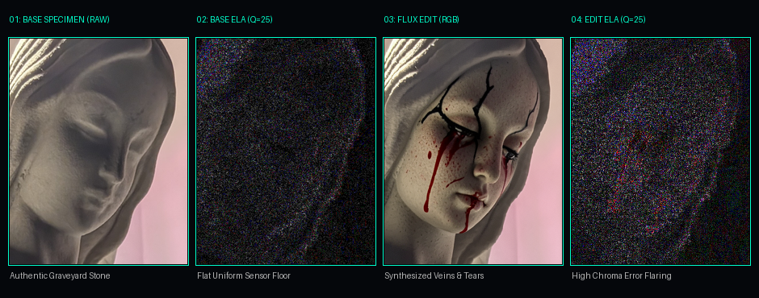
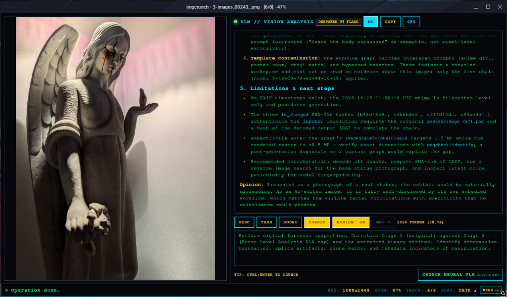
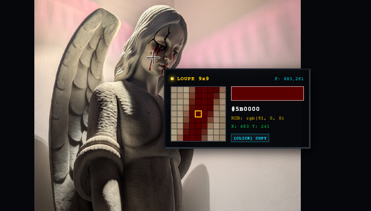

# IMGCRUNCH

```text
 ___ __  __  ____  ____ ____  _   _ _   _  ____ _   _ 
|_ _|  \/  |/ ___|/ ___|  _ \| | | | \ | |/ ___| | | |
 | || |\/| | |  _| |   | |_) | | | |  \| | |   | |_| |
 | || |  | | |_| | |___|  _ <| |_| | |\  | |___|  _  |
|___|_|  |_|\____|\____|_| \_\\___/|_| \_|\____|_| |_|
  [ CLASSIFIED IMAGE VIEWER // 1992 ORIGINAL SEIZURES ]
```

> *"Back in my days, we just took the seizures."*

### Hardware-Accelerated Forensic Inspection, Error Level Analysis & Neural Vision Terminal.
###### Zero telemetry. Zero cloud crutches. Pure offline silicon. It tears into the bytes you feed it, when you feed it.

<br>

<div align="center">
  
</div>

<br>

---

> [!CAUTION]
> ### ⚠️ PHOTOSENSITIVITY WARNING // SEIZURES™ (ORIGINAL 1990s EDITION)
> The violent screen strobing and border flashing during pipeline execution is the **AUTHENTIC 1990s DEMOSCENE CRUNCHER EFFECT™**.
>
> It indicates that the pure Rust native engine is actively decompressing byte streams, computing differential Error Level Analysis matrices, and rasterizing high-density glyphs directly into raw pixel buffers. The presence of violent flashing means the software is **WORKING AS INTENDED**. That is just Rust getting crunched in the background.
>
> Anyone forking this repository to replace the cruncher flash with a sanitized modern circular progress indicator will be summarily and permanently blocked with extreme prejudice.

---

## 💾 The Man & The Machine

While much of modern software has devolved into bloated Electron web wrappers consuming half a gigabyte of RAM just to display a JPEG, clean tools like `qimgv` still exist (and served as a major inspiration here). But every image viewer dictates user workflow.

**IMGCRUNCH is a combo to shmix you up.**

Created and running on Linux, IMGCRUNCH was built to pair a raw, retro UI with blistering native performance. Low-level systems languages like Rust shine at high-throughput pixel crunching, but because of how Rust is structured, complex nested UI trees are notoriously painful to build. Bringing these two worlds together is the idea I had with IMGCRUNCH: embedding handwritten Rust inside Flutter Desktop yields the best of both worlds — a responsive, hardware-accelerated frontend with Rust doing all the heavy computational lifting behind the scenes:

* **Native Filesystem Traversal:** Scans large directories and builds playlists asynchronously in Rust native threads, bypassing Dart GC overhead.
* **Differential Error Level Analysis Engine:** Computes pixel-by-pixel mathematical delta matrices ($Q=25$) directly in Rust native memory.
* **Lanczos3 Specimen Resizer:** Executes high-precision windowed sinc filter interpolation (`image::imageops::FilterType::Lanczos3`) and balanced sub-filter PNG encoding (`PngEncoder` with `FilterType::Sub`).
* **Phosphor ASCII Rasterizer:** Calculates perceptual luminance weights ($0.2126R + 0.7152G + 0.0722B$) and converts pixels to high-density CRT character grids.
* **Binary Firmware / String Sweeper:** Scans raw byte streams for contiguous printable ASCII sequences ($\ge 6$ bytes).

**Actively Dogfooded During Degen Hours:**  
This tool is daily-driven on actual workloads. Features get implemented because the maintainer genuinely needed them to navigate folders of cursed imagery at 3 AM... Another package broke, an image viewer was needed, and things escalated. As such, expect sharp edges, raw corners, active evolution, and mechanics that shift daily based on real-world combat.

* **Zero Telemetry:** The engine runs entirely on local silicon. It does not phone home, ping remote analytics endpoints, or upload your media to centralized silos.
* **Zero Permissions:** IMGCRUNCH operates strictly in unprivileged user space. No root/sudo escalations, no background services. It just opens images, crunches Rust, and blinds you with demoscene raster bars in the process — exactly as intended.

---

## ⚡ Five Forensic Strata (Quake Weapon-Switching)

Mode switching isn't buried in menus or dropdowns. It operates with the twitch-reflex immediacy of **Quake weapon switching**: numerical triggers (`1` through `5`) instantly swap the active forensic weapons without lifting your hand off the keyboard or fumbling with a mouse:

```text
 [1] RAW VIEWPORT    ➔ Hardware-accelerated subpixel pan/zoom matrix
 [2] ELA FORENSIC    ➔ Amplified differential Error Level Analysis (Rust)
 [3] CRT ASCII ART   ➔ Perceptual luminance rasterizer with glowing phosphor glyphs (Rust)
 [4] STRINGS DUMP    ➔ Contiguous printable ASCII byte sequence extraction (Rust)
 [5] NEURAL VLM      ➔ Dual-payload multimodal vision intelligence dossier
```

### `[1]` RAW VIEWPORT // The Specimen Deck
* **Subpixel Pan & Zoom:** Custom coordinate transform matrix supporting seamless freeform zooming (NEAREST NEIGHBOUR when scaling up, LINEAR when scaling down), infinite zoom out, border clamping, and one-key `100%` actual-size focus (`0`).
* **Format Agnostic:** Ingests PNG, JPEG (JPG), GIF (with live animated frame playback), WebP, BMP, and ICO (adding more friends along the way).
* **Instant Ingestion:** Drag-and-drop any file directly into the cathode well, pass it as a CLI argument, or paste image buffers straight from the system clipboard (`Ctrl+V`).

### `[2]` ELA // Error Level Analysis
* **Pure Rust Differential Engine:** Re-compresses the image container against a calibrated baseline ($Q=25$) and computes the absolute pixel-by-pixel mathematical delta in native memory.
* **Tampering Identification:** Exposes digital splicing, cloning, localized brush touch-ups, resaved boundaries, and generative AI inpainting artifacts as brilliant luminous anomalies against uniform dark compression noise.
* **Zero CPU Freezing:** Heavy image differences process inside native worker threads, keeping the UI at a pinned 60fps.

#### 🪦 Forensic Case Study: The Cemetery Angel

<div align="center">
  
</div>

* **The Physical Specimen:** The base photograph is not a stock asset. It is an authentic weathered stone angel statue salvaged from a local graveyard chapel during renovations, currently standing watch in the room right beside my workstation. For decades, it stood out in the cold night air of the town cemetery.
* **The Latent Tampering:** A local generative diffusion pass (Flux.2 Klein 9B) synthesized black forehead fissure veins and weeping blood tears onto the stone face, conditioning the latent space to preserve the statue's physical geometry, drapery, and ambient room lighting.
* **The ELA Physics (Dr. Neal Krawetz Method):**
  * **Authentic Sensor Floor (`01` & `02`):** The untouched camera capture exhibits a flat, uniform sensor noise floor across the stone cheek and forehead. Because all pixels underwent a single optical capture and encode pass, there are zero localized residual spikes.
  * **Chrominance Error Flaring (`03` & `04`):** Despite appearing visually seamless in RGB, the generative edit is exposed instantly. The synthesized red blood tears and dark cracks introduce sharp high-frequency chrominance edges. Under JPEG 8×8 DCT quantization and 4:2:0 chroma subsampling, these modified regions fail to compress at the rate of the surrounding stone, violently flaring into bright red and purple error residuals.

### `[3]` ASCII // Phosphor CRT Rasterizer
* **Perceptual Luminance Mapping:** Converts RGB pixel data to greyscale using calibrated human eye weights ($0.2126R + 0.7152G + 0.0722B$), mapped to inverted CRT character densities (`.`, `:`, `;`, `+`, `*`, `%`, `#`).
* **High-Luminance Phosphor Punch:** Draws glyphs using high-density `#00FF66` phosphor green (`RGBA[0, 255, 102, 245]`) on pure cathode black (`#05070B`), preventing downsampling washout on high-DPI displays.
* **Custom Aspect Correction:** Compensates for non-square font bounding boxes with live configurable character aspect ratios.
* **Instant Clipboard Exfiltration (`Ctrl+C`):** Hit `Ctrl+C` while in Mode 3 to dump the live 110-column rasterized ASCII character matrix directly to your system clipboard for CLI inspection or external piping.

<details>
<summary>📟 View Mode 3 Specimen Telemetry: Raw Cemetery Angel ASCII Matrix (Click to expand)</summary>

```text
**%%%%%%%%%%%%%%%%%%%%%%%%%%%%%%%%%%%%%%%%%%%**********************************************************++++************+
**%%%%%%%%%%%%%%%%%%%%%%%%%%%%%%%%%%%%%%%%%%%***************************************************************************
**%%%%%%%%%%%%%%%%%%%%%%%%%%%%%%%%%%%%%%%%%%%*******%%%%%%%%******************%%****************************************
**%%%%%%%%%%%%%%%%%%%%%%%%%*+++*%%%%%%%%%%%%%*****%%%%%%**+++++************%%%%%****************************************
**%%%%%%%%%%%%%%%%%%%%%%%*;;++++++*%%%%%%%%%*****%%%%*+;;::::.::+********%%%%%%%%%%*************************************
**%%%%%%%%%%%%%%%%%%%%%*;;++**++++++*%%%%%%*****%%**+;;:::::.....:+*****%%%%%%%%%%%*************************************
**%%%%%%%%%%%%%%%%%%%%+;;+*****++++++*%%%%*****%%**+;;:::::.....:::+****%%%%%%%%%%%*************%%**********************
**%%%%%%%%%%%%%%%%%%%+;+*******++++++*%%%%****%%***+::::::::::::::.:***%%%%%%%%%%%%********%%%%%%%%%********************
***%%%%%%%%%%%%%%%%%+;+*****%*+++++*+%#%%%%***%*%*+:::::::::...::...;**%%%%%%%%%%%%***%%%%%%%%%%%%%%********************
***%%%%%%%%%%%%%%%%+;*+****%*+;;++*+*%%%%%%***%%*+;:::::::::....:::.;*%%%%%%%%%%%%%%%%%%%%%%%%%%%%%%**************++****
***%%%%%%%%%%%%%%%+;+****%%*++;;+++*%#%%%%***%%*+;:::::.:::...:::::::*%%%%%%%%%%%%%%%%%%%%%%%%%%%%%%*************+++****
****%%%%%%%%%%%%%+;+*******++;;;++**%%%%%***%*+;::::::::::....:::::::*%%%%%%%%%%%%%%%%%%%%%%%%%%%%%%%*************++****
****%%%%%%%%%%%%+:+*******+++;:;+**%%%%%%**%*++;::;;::;+;;:.::::::::;*%%%%%%%%%%%%%%%%%%%%%%%%%%%%%%%*************++****
*****%%%%%%%%%%*:;*******+**+;;;+*%%%%%%%%**+;++;;:::::;;:.:;:::::::;%*%%%%%%%%%%%%%%%%%%%%%%%%%%%%%%*************+++***
****%%%%%%%%%%*;;+******;+**;++;+*%%%%%%%*++;;++:::;;:. ... :;:;;:;;*%%%%%%%%%%%%%%%%%%%%%%%%%%%%%%%%%************+++***
***%%%%%%%%%%%;;+++****+;+*+;++++%%%%%%%*+*;:;;;::;+;:      .::::;;+%%%%%%%%%%%%%%%%%%%%%%%%%%%%%%%%%%*************++***
%%%%%%%%%%%%%+:+*******++++:;++**%%%%%%%***+::;;:;+++:     .....:;;*%%%%%%%%%%%%%%%%%%%%%%%%%%%%%%%%%%*************+++++
%%%%%%%%####%;;+*********+::;++*%#%%%%%%**+;::;;;+++;::....::...::+%%%%%%%%%%%%%%%%%%%%%%%%%%%%%%%%%%%**************++++
%%%%#######%+:+++****+***;;:;+**##%%%%%+*+;;;++;;++++;;:...::.::::*%%%%%%%%%%%%%%%%%%%%%%%%%%%%%%%%%%****************+++
%%%########*:;+++***+****;;;++*%#%%%%%*+++++++;:+++++;;:...:;;;;:;**%%%%%%%%%%%%%%%%%%%%%%%%%%%%%%%%*****************+++
%%%%######%+:++++***;+***;++++*%#%%%%*;;**+;;;::++*+;+;:::..;;;::+**%%%%%%%%%%%%%%%%%%%%%%%%%%%%%%%%****************++++
%%%%%####%*:++++***+;;+*+;+++**###%%*+;+**;:;.:;;+++;+;:::.:;;::+**%%%%%%%%%%%%%%%%%%%%%%%%%%%%%%%%%**************++++++
%%%%%%##%%+;++++***+++++;;++***####%++**++:::.:;::;;;+;::::;;::+***%%%%%%%%%%%%%%%%%%%%%%%%%%%%%%%%%*************+++++++
%%%%%%%%%%;;+++++**++**+;;+****####%+****+;:..:;::::;;;:::;;:.;****%%%%%%%%%%%%%%%%%%%%%%%%%%%%%%%%*************++++++++
%%%%%%%%%*:;+++++*+++**++++****####%****+;:..::::...::;;:::..:+****%%%%%%%%%%%%%%%%%%%%%%%%%%%%%*%*************+++++++++
%%%%%%%%%+:;;;+++++++**++**+*+*%%%%%+++;:.  .......::;;;::..:+*****%%%%%%%%%%%%%%%%%%%%%%%%%%%*************************+
%%%%%%%%%;:;;;;++;+++**++**+++*%#%%%%%%+:..........:::;;:.:;+****%**%%%%%%%%%%%%%%%%%%%%%%%%%***************************
%%%%%%%%*::;;;;++::++**;;+++*%%%#%####%*;..........::::;::++*%***%**%%%%%%%%%%%%%%%%%%%%%%%%****************************
%%%%%%%%+:::;;;+;:::;++;:;+****%%%%%%%%%*:.........::.:;:+++%%***%**%%%%%%%%%%%%%%%%%%%%%%**********%%%%%****%%%%%%%%%**
%%%%%%%%;:;;;;;;;;;;;+;;;:;:;;+****%%%%%%+:........:..:;;*+*%****%%*%%%%%%%%%%%%%%%%%%%%***%%%%%**%%%%%%%%%%%%%%%%%%%%%%
%%%%%%%%::;;;;;;;;;;;;;:;;..::+++***+*%%%*;...........::;++*%****%**%%%%%%*;+%%%%%%%%%%%*%%%%%%%%%%%%%%%%%%%%%%%%%%%%%%%
%%%%%%%*::::::;;::;;;;::;:...:;;+***;:+%%%+:.............;+**********%%%%%+.:*%%%%%%%%%%%%%%%%%%%%%%####%%%%%%%%%%%%%%%%
%%%%%%%+::::::::::::;;:.:......:;++*+.:**%*;.......... ..:;**********%%%%%*..;*%%%%%%%%%%%%#####%%########%%%%%%%%%%%%%%
%%%%%%%;.::::::::::::::........:;****..;***;.. ........ ..:+***********%%%+...+%%%%%%%%%%%#################%%%%%%%%%%%%%
%%%%%%%;.::::::..::::::.......:;++***:.:+**;.. ............:;**********%%%;...;%%%%%%######################%%%%%%%%%%%%%
%%%%%%*:.::::::...:::::::.....:++****:.::+*;..  ........ ..::+**********%%;...;%%%%%#######################%%%%%%%%%%%%%
%%%%%%*:.::::::.....:.:;:.....;+++*++:.:::;:.   ......... .:.:+**********%;...+*++;;;*###################%%%%%%%%%%%%%%%
%%%%%%*..:::::::......;;:.....:++++*+:.::.....  ......... ....;*******++++;...;:..:::+%################%%%%%%%%%%%%%%%%%
*%%%%%+......:::.::::.;+:....:;+*+***..:::...... ........ .....+****+:...........::;+%################%%%%%%%%%%%%%%%%%%
*%%%%%+.......:..::;:.;;:....:;+***++..:;::::....  ...... .....:***+.........:::::+%%###############%%%%%%%%%%%%%%%%%%%%
**%%%%+.......:.:::;:..:.....;;+****+..:;;:::..... .....  ......;*+. .....:::;;;+*%##############%%%%%%%%%%%%%%%%%%%%%%%
**%%%%;.......:.::;;;.......:;+**%**+..:;;::::...   ....  ......:*:. ..::;+**%%%%%%%###########%%%%%%%%%%%%%%%%%%%%%%%%%
**%%%%;......::.:;;++;*;...:;++*****+..:;;:::....   ...   ...:...;.  ..::*%%%%%%%%%%#######%%%%%%%%%%%%%%%%%%%%%%%%%%%%%
+**%%%;......::.:;++**%;.:;+*%%%%%**+..:;;;::...    .    ....::.:.   ..:;%%%%%%%%%%%%%%%%%%%%%%%%%%%%%%%%%%%%%%%%%%%%%%%
;++**%;......::..:+*++%;+********%%%*...:;;;::.....      .....:::.   ..:+%%%%%%%%%%%%%%%%%%%%%%%%%%%%%%%%%%%%%%%%%%%%%**
;;;+**;.....::;:...:.;*+;;:::;:::;+**;..:;;;::...      .......:::    ..:+%%%%%%%%%%%%%%%%%%%%%%%%%%%%%%%%%%%%%%%%%%%%***
;;;;+*;......:;;:::;::;::;+*****++;;;+: .::::....     .........::    ..:*%%%%%%%%%%%%%%%%%%%%%%%%%%%%%%%%%%%%%%%%%%%****
;;;;++;.....::;+++**::+++++;;;;;+***;:. .:::...................::    ..;%%%%%%%%%%%%%%%%%%%%%%%%%%%%%%%%%%%%%%%%%*******
;;;;;+;....::;;++**+:+;:..........:;*+. ..:::..................::.  ..:;%%%%%%%%%%%%%%%%%%%%%%%%%%%%%%%%%%%%%%%%********
;;;;;+;...:::;;++**::...............:;: ...::.................::::  ..:+%%%%%%%%%%%%%%%%%%%%%%%%%%%%%%%%%%%%%%%%********
:;;;;;:...:::;+*+*+........       .....  ........         .....:::  ..:*%%%%%%%%%%%%%%%%%%%%%%%%%%%%%%%%%%%%%***********
::;;;;;....::;+*+*:......           ...  ...           ........:::....;%%%%%%%%%%%%%%%%%%%%%%%%%%%%%%%%%%%%*************
:::;;;;...::;;+*++.....               .                ........::....:+%%%***%%%%%%%%%%%%%%%%%%%%%%%%%%%%%**************
::::;;;...::;;++;;....                                 ........::...:;%%**+++*%%%%%%%%%%%%%%%%%%%%%%%%%%%%**************
::::;;;...::;;++......                                 ........::...:*%*+++++*%%%%%%%%%%%%%%%%%%%%%%%%%%%%**************
:::::;;..::;;++;.....                                   ........::.:***+++++++*%%%%%%%%%%%%%%%%%%%%%%%%%%***************
::::::;...:;;;+*:....                                     ......:::**+++++++++*%%%%%%%%%%%%%%%%%%%%%%%%%****************
::::::::.....;*+;....     .      .:;:.                    ......::**++++++++++*%%%%%%%%%%%%%%%%%%%%%%%%%****************
::::::::...::+++;:...    ..     :+***;                    ......::++++++++++++*%%%%%%%%%%%%%%%%%%%%*********************
::::::::.;;;+++;;:...     .    :+****+.    ...  .  ..    ........:;++++++++++++%%%%%%%%%%%%%%%%%%%**********************
::::::::.;;+++;;:....     .   .;**%%**.    ...... ....  .........:;;;;+++++++++%%%%%%%%%%%%%%%%%%***********************
::::::::.;;;;;;::.  ..    .   .;**%***:    ......................::;;;;;;++++++*%%%%%%%%%%%%%%%*************************
.:::::::.;;;;;::..   ..   .    :+*****;    ......................::;;;;;;;+++++*%%%%%%%%%%%%%***************************
...:::::.;;;:::..         .    .;*****+    ......................::;;;;;;;;++++*%%%%%%%%%%%%****************************
.....:::.::::::..         ..   ..;****+.   ......................::;;;;;;;;++++*%%%%%%%%%%******************************
......::..;::::.          .......:+***+.   .......................:;;;;;;;;;+++***%%%%%%%*******************************
.......:..::::..           .......;+***.   .......................::;;;;;;;;+++***%%%%%%********************************
..........:::..            .......;****:   ................ .....:::;;;;;;;;+++****%%***********************************
...........:...            ......:;++**:   ......................::::;;;;;;;+++*****************************************
..............              ......:;+**:   ......................:::::;;;;;;+++*****************************************
.............               .......;+**;   ......................:::::;;;;;;+++*****************************************
............                .......;***;   ......................:::::;;;;;;++++****************************************
............                 .....:;+**+.  ......................:::::;;;;;+++++****************************************
...........                  .....:;****.   .....................:..::;;;;;+++++****************************************
...........                   .....;+***:   .........................:;;;;;+++++****************************************
...........                   ....:;++**:   .........................:;;;;;+++++****************************************
...........                   ....;++***;    ........................:;;;;;+++++****************************************
...........                    ...+*****+.      ..... ...............:;;;;;+++++****************************************
............                   ..:***%%%*;  .:;;;:..     .  ..........:;;;++++++****************************************
............                    .+*%%%%%%*; ;*%%***+;.      ..........:;;;++++++****************************************
............                   .+**%%%%%%**::;+****++;.     ..........:;;;+++++*****************************************
............                   :******%%%%*+;**;;+:::::.     .........:;;++++++*****************************************
............                   +*******%%%*****+.:.::...     .........:;+++++++*****************************************
.............                 .**********%*++***;::++:..     .........:;++++++******************************************
.............                 :*******%**%+...:;+;*%**;..    ..........;++++++******************************************
.............                 :*++****%%***;. .;**%***+:.    ..... ....:+++++++****************************************+
.............                 ;***%%*******;. .*%*+::::;:    .....  ...:+++++++****************************************+
.............                 +*********+;;.  .+**;    ::.   ..... ....:++++++****************************************++
..............                +**;++;:;+:     .:::+;.   ..   ..... ....:++++++***************************************+++
..............                .;+..:. .:.     .   :::...     ..... ....:+++++****************************************+++
..............                  :                     ..     ....  ....:+++++**************************************+++++
..............                                       ...     ....   ...:++++*****************************************+++
..............                                               ....   ...:+++*****************************************++++
...............                                    ..        ....   ....++*******************************************+++
...............                        .     .     ..        ....    ...;********************************************+++
...............                        .     ..    ..        ...     ...;*+****************************************+++++
...............                               ..   ..         ..     ...;++****************************************+++++
...............                               ..   ..         ..      ..;++++************************************++*++++
................                              ..   ..         ..      ..:+++++***********************************+++++++
................                              ..    .         ..      ..:+++++***********************************+++++++
................                              .     .          ..     ..:+++++++******************%%*************+++++++
................                                    .          ..     ..:++++++++*****************%%%***********++++++++
.................                                   .          ..     ...;++++++++*****************%%%***********+++++++
.................                                   .          ..      ..;+++++++++*****************%************+++++++
.................                                   .          ..      ..;++++++++++***************%%%%**********+++++++
.................                                   .          ..       .:++++++++++******************************++++++
.................                                   .           .       .:+++++++++++*****************************++++++
..................                                  .           .       .;++++++++++++**************%*************++++++
..................                                             ...     ..;;;;++++++++++****************************+++++
..................                                  .        .....     .;;;;;;++++++++++***************************+++++
..................                                  .          ..     .:;;;;;;;+++++++++***************************+++++
```

</details>

### `[4]` STRINGS // Firmware & Binary Artifact Dump
* **Raw Byte Extraction:** Sweeps the raw file byte stream for contiguous printable ASCII sequences (configurable minimum length $\ge 6$ bytes).
* **Metadata Exfiltration:** Instantly surfaces hidden camera models, EXIF timestamps, software signatures, GPS tags, embedded ComfyUI generation prompts, and steghide trailers without requiring external CLI utilities.

### `[5]` NEURAL VLM // Multimodal Forensic Dossier

<div align="center">
  
</div>

* **Dual-Image Forensic Fusion (`FUSION: ON`):** Simultaneously transmits Image 1 (original RGB visual capture) AND Image 2 (calibrated ELA difference map) alongside extracted binary strings directly into frontier vision language models (DeepSeek, Gemini, GPT-4o, or local Ollama / vLLM / LM Studio backends).
* **Ground-Truth Environment Telemetry:** Automatically injects atomic UTC timestamps, exact byte sizes, file modification times, and extracted strings into the prompt context to ground the model and eliminate temporal or spatial hallucinations.
* **Sunken CRT Markdown Terminal:** Streams real-time SSE token responses into a retro terminal featuring phosphor headers, glowing amber callouts, and steel-bordered code containers wrapped in native mouse `SelectionArea`.
* **Dual `[MD / RAW]` Mode:** Toggle between formatted forensic dossier reports and raw token dumps with a single click.

> [!IMPORTANT]
> **Data Reality: Why Raw VLMs Fail (And Why Multimodal Telemetry Matters):**  
> Frontier vision language models looking at raw RGB pixels alone **cannot reliably detect generative AI or image tampering**. They rely on superficial visual heuristics, frequently hallucinating false positives on authentic photographs (such as mistaking natural optical depth-of-field or weathered stone for "diffusion smoothing") while missing polished synthetic renders entirely.  
>  
> **IMGCRUNCH flips the equation:** Instead of asking a neural net to blindly guess, Mode 5 feeds the model objective mathematical telemetry:
> 1. **The ELA Differential Map (`Image 2`):** Exposes mathematical DCT quantization rate mismatches and compression boundaries invisible in standard RGB space.
> 2. **Printable Binary Strings:** Extracts embedded ComfyUI node graphs, positive/negative prompts, seed values, and model checkpoints buried in raw bytes that would take an analyst hours to manually sift.
> 3. **Hardware Telemetry:** Anchors the prompt with exact byte lengths, modification timestamps, and decoded container chunks.  
>  
> This transforms the VLM from an unreliable guessing oracle into a **high-speed anomaly correlation engine** — rapidly cross-referencing buried binary strings against visual regions and outlining leads in seconds, while the human technician cross-examines the output against ground truth.

<details>
<summary>📜 Full Multimodal Forensic Dossier: DeepSeek-V4-Flash Autopsy (Click to expand)</summary>

### Forensic Examination Report — `3-images_00243_.png`

**Exhibit:** Angel statue with facial "blood tear" and vein/crack edits  
**Analysis window:** 2026-10-28 16:35:38 UTC · **Container:** PNG, 2,513,651 bytes, ~3:4 portrait (~0.8 MP rendered)  
**Verdict (high confidence, ~99%):** Not a photograph of a physically modified statue. The file is a **whole‑frame generative synthesis** (diffusion img2img conditioned on a source image) whose embedded provenance explicitly describes the exact edits visible in the face. There is no evidence of classical paste/splice, resave, or clone‑stamp manipulation — because none was required: **every pixel is synthetic.**

---

#### 1. Metadata — Decisive, Self‑Authenticating Provenance

The PNG carries two `tEXt` chunks: `prompt` (ComfyUI API graph JSON) and `workflow` (full UI graph). They are internally consistent (node IDs, link IDs, and subgraph UUIDs cross‑reference), proving original tool output rather than external injection.

| Indicator | Value | Significance |
|---|---|---|
| Generator | ComfyUI (frontend 1.47.12, core 0.8.2/0.22.3) | No camera/phone/editor toolchain |
| Diffusion Model | `gonzalomoKlein_v10.safetensors` (FLUX‑2‑Klein base 9B, fp8_e4m3fn) | Text‑to‑image / image‑to‑image generative model |
| Text Encoder / VAE | `qwen_3_8b_fp8mixed`, `flux2-vae` | Confirms generative pipeline |
| Sampling Engine | `euler`, **4 steps**, `cfg 1.0`, seed **574801320118512** | Low‑step distilled sampler, deterministic seed |
| Conditioning | Nodes `50:46`/`50:47` = `ReferenceLatent` + `VAEEncode` of input | Output is a **re‑render guided by the source**, not a patch |
| Output Target | `SaveImage`, prefix `3-images` → counter `00243` | Filename matches exactly → generated as 243rd save of that session |
| Specimen Inputs | `attachment (base)`, `attachment (reference)` | External specimen buffers; `is_changed` SHA‑256 hashes verified |
| EXIF / XMP / C2PA | **Absent** | No physical camera or signed C2PA provenance manifest |

**The smoking gun is the active positive prompt (node 8):**

> *"work on the picture of the angel graveyard statue. **add subtle black veins near the eyes and blood tears. do not change the original shape just add the texture on the current stone statue face shape** … do not change face shape, apply the edits as textures above the surface … do not change the environment, just work on the light … work on the angel face, leave the body untouched."*

Every semantic novelty in the image — the branching dark veins across the forehead/temples, the red tear tracks from both eyes, their pooling at the jaw — is specified item‑by‑item in that string. **Correlation is 1:1, including localization to the face only.**

**Template Contamination:** The `workflow` graph embeds unrelated prompts (anime girl, poster room, emoji patch) and bypassed branches (`mode: 4`). These indicate a recycled workspace and must not be read as evidence about this image; only the live generation chain (nodes `8➔49➔50➔79➔42➔44➔16➔18`) applies.

---

#### 2. ELA (Image 2) vs. Image 1 — What the Residual Actually Shows

| ELA Observation | Interpretation |
|---|---|
| Uniform, low‑amplitude grain across the **entire** canvas — including flat, featureless wall areas upper‑right and lower‑left | The most diagnostic finding. A real photograph's flat wall would residualize near‑black after Q25 recompression. Grain here follows no scene structure → **synthetic noise field applied globally**, i.e., the whole frame was generated, not patched. |
| Statue silhouette rendered as coherent blue/violet edge‑following texture (wing, drapery folds, hair strands, sleeve) | Residual tracks genuine high‑frequency detail, not a rectangular block boundary. |
| Mild warm/reddish elevation concentrated at the **eye/cheek/jaw region**, and along the emissive tear streaks | High chroma + fine high‑contrast strokes = high local residual. Consistent with the inserted textural edit, and consistent with edge‑density behavior generally. |
| **No** 8×8/16×16 JPEG block grid, **no** rectangular islands of mismatched error level, **no** straight or polygonal seams at the shoulder, sleeve, or wing/body junction | Container is lossless PNG → no DCT lattice to inherit. ELA difference comes solely from the recompression baseline, proving the entire frame shares **one single compression history**. |
| No duplicated high‑residual blocks, no mirrored repeating patches | **Zero evidence of classical copy‑move / clone‑stamp manipulation.** |

**Compression Boundary Conclusion:** There is no paste boundary to find, and that is itself the forensic finding. A composite of photo + retouched face would betray a boundary at the face perimeter. Here the transition from smooth stone cheek to cracked, weeping occlusion is *seamless in residual terms* — the signature of a single generative pass, not a paste.

---

#### 3. Cross‑Check: Physical & Photographic Plausibility

| Feature | Observation | Forensic Weight |
|---|---|---|
| Veins + Tears | Radially branching from hairline, running medially, correct gravity direction, pooling at the jaw; hue is saturated and slightly lacquer‑like against matte stone | **Matches prompt verbatim**; material response plausible but synthetic |
| Raised Hand (Viewer Right) | Fingers show fused/blunted tips, soft crease topology, no nail plates | Classic diffusion hand artifact |
| Lower Hand + Roses | Fingers merge into the rose cluster; petals are mushy, edges dissolve without separate silhouette | Generative blending, not a carved stone surface |
| Lighting & Shadows | Pink cast upper right, rim highlight on wall, cast shadow of raised hand falls down‑left, consistent with key light | Internally consistent — prompt instructed *"just work on the light"*, preserving shadow topology |
| Statue Anatomy | Wing meets shoulder without a carved attachment seam; sleeve cuff terminates ambiguously against wall | Typical reference‑conditioned latent re‑render behavior |
| File Entropy | 2.40 MB for ~0.8 MP ≈ 3 B/px | High for a smooth photographic subject; consistent with full‑canvas synthetic noise texture (corroborating ELA grain) |

> [!NOTE]
> **Analyst Reality Check (VLM Overfitting & Confirmation Bias):**  
> Notice that while DeepSeek correctly isolates the synthetic facial blood tears and cracking, it exhibits classic AI confirmation bias in Section 3: diagnosing the blunted fingers, weathered rose cluster, and ambient lighting as *"diffusion artifacts"*. In physical ground truth, the century-old cemetery statue actually possesses those exact weathered stone carving features and was photographed under the room's real ambient light spill! The latent reference conditioning preserved the physical carving rather than generating it from scratch. This illustrates why IMGCRUNCH is engineered as an investigator's cockpit: neural vision models rapidly surface forensic leads, but human ground truth remains the ultimate arbiter.

---

#### 4. Summary Findings

1. **Metadata is the primary and conclusive evidence.** Embedded `tEXt` chunks name the generator, the model, the sampling parameters, the seed, and — critically — a prompt that predicts the blood tears and periorbital veins observed in Image 1. Filename `3-images_00243_.png` matches the `SaveImage` prefix/counter.
2. **Manipulation Class = generative whole‑frame synthesis with reference‑latent conditioning**, not splice, not retouch, not copy‑move.
3. **No compression boundaries or splice artifacts** — none are expected from a lossless PNG produced in a single generation pass; the ELA's homogeneous grain over empty wall confirms global synthesis.
4. **No clone marks.** Naturally varying repeats (feathers, folds) and no rectangular residual duplication.
5. **Semantic localization ≠ pixel localization.** The *edit* is confined to the face, but the *generation* is not — that asymmetry is exactly what the ELA shows and what the prompt instructed (*"leave the body untouched"* is semantic, not pixel‑level exclusivity).
6. **Template contamination:** The `workflow` graph carries recycled nodes from prior workspace templates; only the active execution chain applies.

**Forensic Opinion:** Presented as a photograph of a real statue, the exhibit would be materially misleading. As an AI‑edited image, it is fully self‑disclosed by its own embedded workflow, which matches the visible facial modifications with specificity that no coincidence could produce.

</details>

---

## 🔬 The Surgical Pixel Peeker (`P`)

<div align="center">
  
</div>

Press `P` to deploy the floating **9x Nearest-Neighbor Pixel Peeker Loupe**:
* **Subpixel Reticle:** Centers a calibrated high-precision crosshair over any pixel coordinate.
* **Hardware Readout:** Displays exact `(X, Y)` spatial coordinates, 24-bit hexadecimal color code (`#RRGGBB`), and raw 8-bit `RGB(r, g, b)` channel values in real time.
* **Subpixel Grid Canvas:** Renders a magnified 9x9 pixel grid with hairline wireframe borders for inspecting compression edge discontinuities, high-frequency boundary shifts, and steganographic color modifications.
* **One-Click Hex Exfiltration:** Single-click or press Enter to copy the active `#RRGGBB` hex string directly to the clipboard buffer.

---

## 📐 Hardware-Accelerated Lanczos3 Specimen Resizer (`R`)

Press `R` to engage the **Retro Lanczos3 Specimen Resizer**:
* **High-Fidelity Windowed Sinc Filter:** Executes `image::imageops::FilterType::Lanczos3` in native Rust worker threads, delivering razor-sharp downsampling and upscaling without blurring high-frequency details.
* **Dual Interpolation Engine:** Uses `Lanczos3` for high-precision resizing and fast bilinear thumbnailing (`image_thumbnail`) with balanced sub-filter PNG compression (`PngEncoder` with `FilterType::Sub`).
* **Bidirectional Percentage Fader:** Live interactive slider scaling from 10% to 400%, paired with direct pixel dimension inputs (`Width` / `Height`).
* **Aspect Ratio Constraint:** Toggle aspect locking on/off to scale proportionally or stretch to arbitrary custom dimensions.
* **Instant Calibration Presets:** One-click presets (`25%`, `50%`, `75%`, `100%`, `150%`, `200%`) for rapid targeting.
* **Non-Destructive Output:** Export safely as `filename_resized.png` without overwriting the active specimen directly.

---

## ⌨️ Mapped Controls

| Key Trigger | Action & Operation |
| :--- | :--- |
| `1` | Switch to **Mode 1: Normal Viewport** |
| `2` | Switch to **Mode 2: Error Level Analysis (ELA)** |
| `3` | Switch to **Mode 3: Phosphor CRT ASCII Art** |
| `4` | Switch to **Mode 4: Forensic Strings Extraction** |
| `5` | Switch to **Mode 5: Multimodal VLM Neural Terminal** |
| `←` / `Space` | Advance to **Next Specimen** in playlist directory |
| `→` / `Backspace` | Return to **Previous Specimen** in playlist directory |
| `Home` / `End` | Jump directly to **First** / **Last Specimen** in playlist |
| `Del` | Delete active specimen from disk *(Summons retro confirmation dialog)* |
| `R` | Open **Lanczos3 Specimen Resizer** fader console |
| `P` | Toggle **9x Forensic Pixel Loupe** inspection reticle *(Click copies `#HEX`)* |
| `0` (Zero) / `Numpad 0` | Reset Zoom to **100% Actual Scale** / Toggle Fit to viewport |
| `+` / `=` | Zoom In (+25% focal scale) |
| `-` | Zoom Out (-25% focal scale) |
| `Ctrl + Scroll` | Smooth Focal-Point Zoom (0.02x – 50x magnification) |
| `Double Click` | Toggle 100% actual scale at cursor focal point |
| `Middle Click` | Reset viewport zoom and pan coordinates |
| `C` | Copy **Full File Path** of active specimen to clipboard |
| `Ctrl+C` | Contextual Copy *(Raw image bytes / ELA / ASCII text / Strings / VLM report)* |
| `Ctrl+V` | Ingest image buffer directly from system clipboard into specimen deck |
| `O` / `Ctrl+O` | Launch native single-file ingestion picker |
| `Shift+O` | Open directory / playlist folder |
| `Alt+O` | Open direct path entry dialog |
| `S` | Cycle sort criterion: `Name` ➔ `Date` ➔ `Size` |
| `Shift+S` | Toggle sort direction: `Ascending` ⇄ `Descending` |
| `F5` | Refresh directory playlist |
| `M` | Open Retro Bottom Menu Console |
| `H` / `F1` | Summon in-engine Command Reference Dossier |
| `Ctrl+Enter` | Trigger **Neural VLM Crunch** *(in Mode 5)* |
| `Esc` | Abort active VLM stream / Defocus terminal / Close modal dialogs |


---

## 💻 Headless Terminal Engine (CLI)

IMGCRUNCH is a dual-headed dog. In addition to the hardware GUI, it functions as a headless command-line utility for shell scripting, automated ELA generation, and terminal ASCII art piping:

```bash
# Launch interactive GUI directly into a specific mode
imgcrunch photo.jpg
imgcrunch --mode=ela evidence.png
imgcrunch --mode=vlm anomaly.webp

# Headless Error Level Analysis (saves photo_ela.png)
imgcrunch --ela photo.jpg
imgcrunch --ela photo.jpg -o diff.png --scale 35

# High-quality Lanczos3 image resizing (saves photo_resized.png)
imgcrunch --resize photo.jpg -w 1920
imgcrunch --resize photo.jpg -p 50 -o thumb.png

# Convert image to terminal ASCII art (stdout or file)
imgcrunch --ascii photo.jpg -w 120
imgcrunch --ascii photo.jpg -o art.txt --aspect 0.65

# Extract printable forensic strings (minimum length >= 8 bytes)
imgcrunch --strings firmware.bin -n 8 -o strings.txt

# Inspect CLI manual and syntax
imgcrunch --help
imgcrunch --version
```

---

## 🛠️ Native Linux & Portable Windows Compilation

### Linux Prerequisites & Clean Installation
* **Supported OS:** Linux x86_64 or aarch64 (Arch Linux, Debian/Ubuntu, Fedora)
* **Build Toolchain:** Flutter 3.24+, Rust 1.80+ (`cargo`), `clang`, `cmake`, `pkg-config`, `libgtk-3-dev`

```bash
git clone https://github.com/maocide/imgcrunch.git
cd imgcrunch

# Clean build & native system installation (~/.local/bin + desktop launcher)
./install.sh --clean
```

#### Installer Flags
```text
Usage: ./install.sh [OPTIONS]

Options:
  --clean          Purge Cargo and Flutter build caches before compiling (Recommended on update)
  --skip-build     Skip compilation and install existing release bundle
  --no-default     Do not register imgcrunch as default system image viewer
  --uninstall      Cleanly remove binary, desktop entries, and hicolor icons
  -h, --help       Show installer help
```

### 🪟 Cross-Platform Portability Note
* **Primary Target:** Developed, benchmarked, and tuned exclusively on Linux.
* **Portable Foundation:** Built entirely on Flutter Desktop and pure Rust (`flutter_rust_bridge` v2) with zero Linux-specific desktop hacks. The core engine and UI are architecturally portable to Windows (`flutter build windows --release`), subject to platform-specific directory-watcher adjustments (`ReadDirectoryChangesW`) and user config storage paths.

---

## 📡 Communications & Policy

* **Issues:** I have no issue.
* **Roadmaps:** Non-existent.
* **Support:** I hope it compiles.
* **Forks:** Fork whatever you want under GPLv3. But if you strip the cruncher flashing effect, you will be permanently blocked with extreme prejudice.

---

> **⚠️ DISCLOSURE & AGE CLASSIFICATION**
> 
> LLMs may have been utilized to assist in the production or conceptualization of certain software components or visual assets. However, all final architectural, cryptographic, and artistic decisions were strictly enforced by demi-human intervention. No LLMs were harmed during production.
> 
> Furthermore, all fictional entities, digital waifus, and anthropomorphic representations ingested, rendered, or depicted herein are categorically 18 years of age or older at the time of drawing, editing, or generating, regardless of spatial-temporal paradoxes, suspension of disbelief, or stylistic proportions.

---

<div align="center">
  <sub>Forged in <b>maocide</b>'s Lab // <i>"You can't kill what's already dead."</i></sub>
</div>
